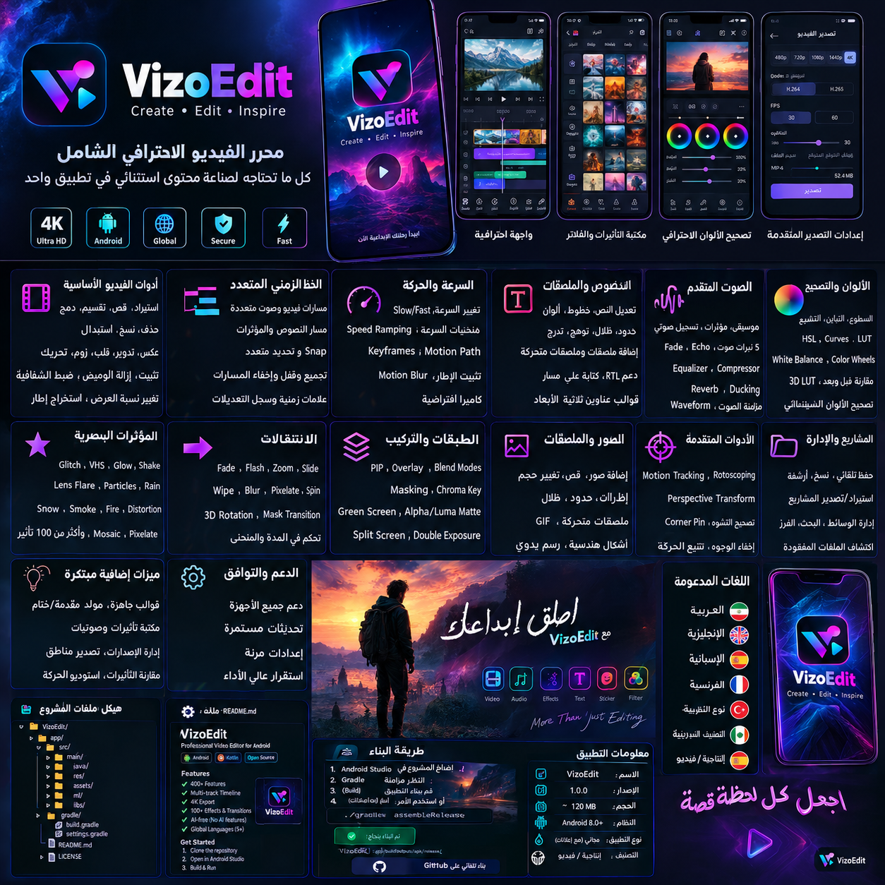
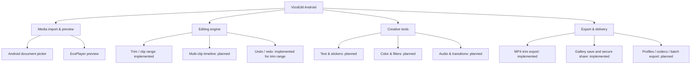

<div align="center">
  <h1>🎬 VizoEdit</h1>
  <p><strong>Android Video Editor • Create · Edit · Inspire</strong></p>
  <p>مشروع محرر فيديو أصلي لأندرويد، بواجهة عربية RTL وهوية بصرية داكنة.</p>
  
  <p><em>الصورة أعلاه لوحة تعريفية تصورية للهوية واتجاه المنتج، وليست لقطة شاشة تؤكد أن كل الميزات المصورة نُفذت.</em></p>
</div>

---

## 🇸🇦 نبذة بالعربية

VizoEdit مشروع Android أصلي مبني باستخدام Kotlin وJetpack Compose. النسخة الحالية هي **قاعدة تنفيذ فعلية قابلة للتطوير وليست محررًا مكافئًا لـ CapCut بعد**. تتضمن مسارًا حقيقيًا لاختيار فيديو من الجهاز ومعاينته، وضبط بداية ونهاية القص، ثم معالجة المقطع وتصديره إلى MP4 باستخدام Media3 Transformer.

### ما يعمل في هذه النسخة (منطق المصدر؛ بناء Android لم يُتحقق منه هنا)

- [x] تطبيق Android أصلي بواجهة Jetpack Compose، لا موقع ويب.
- [x] اختيار فيديو من ملفات الجهاز ومعاينته باستخدام ExoPlayer.
- [x] تحديد بداية ونهاية المقطع، تحريك مؤشر التشغيل، والتراجع/الإعادة عن حدود القص.
- [x] تصدير مقطع واحد إلى MP4 باستخدام Media3 Transformer.
- [x] تطبيق الدوران والتكبير، قص الإطار من الحواف الأربع، ونسب أبعاد الإخراج القياسية عبر مؤثرات Media3.
- [x] تصحيح السطوع والتباين وHue والتشبع والإضاءة وقنوات RGB، مع 11 وصفة ألوان جاهزة تُطبق أثناء التصدير.
- [x] إضافة نص أو Emoji ثابت إلى التصدير عبر Media3 TextOverlay، وتحديد موضعه وحجمه ولونه وشفافيته ودورانه. الملصق ثابت طوال المقطع وليس مسارًا زمنيًا مستقلًا.
- [x] التحكم بمستوى صوت المقطع الأصلي وكتمه وتلاشي الدخول/الخروج. لا يوجد خلط مسار موسيقى منفصل بعد.
- [x] اختيار 24/25/30/50/60 FPS، وطلب H.264 أو H.265، ومعدل بيانات الفيديو، وAAC bitrate. قد يرجع الترميز إلى خيار متوافق حسب إمكانات الجهاز.
- [x] حفظ إعدادات التحرير السابقة ضمن ملفات المشاريع بصيغة JSON ذات مخطط متوافق مع الإعدادات الافتراضية القديمة.
- [x] حفظ ملف MP4 في مساحة التطبيق، ونسخه إلى المعرض على Android 10+، ومشاركته عبر FileProvider.
- [x] استخراج إطار PNG، حفظ بيانات المشروع واستعادتها عندما يظل URI المصدر متاحًا.
- [x] اختبارات وحدة لنماذج القص والمسارات والتحقق ووصفات الألوان وخيارات الترميز.
- [x] GitHub Actions لتشغيل اختبارات الوحدة ثم بناء Debug APK ورفعه كـ Artifact.

### ما لا يزال ناقصًا

- المحرر الحالي ما زال يصدّر **مقطع فيديو واحدًا** في كل مرة؛ لا يوجد بعدُ مسار تصدير لتركيب عدة مقاطع أو مزج مسارات متداخلة.
- لا تزال الانتقالات بين المقاطع، keyframes في التصدير، speed ramp، إزالة الخلفية، chroma key، تتبع الحركة، تقليل الضوضاء، تسجيل الصوت، خلط موسيقى خارجية، وفلاتر GLSL المخصصة غير منفذة.
- وصفات اللون والقص والدوران والنص والصوت والترميز متصلة بمسار التصدير البرمجي، لكن لم يتم التحقق من بنائها على جهاز Android في هذه البيئة.
- معاينة الفيديو لا تعرض بعد كل مؤثرات التصدير لحظيًا؛ بعضها يظهر عند اكتمال الرندر فقط.
- لا يوجد ضمان لعمل H.265 أو كل bitrate على كل هاتف؛ محرك Media3 يطلب الإعدادات ثم يعتمد على ترميز الجهاز المتاح.

## Feature map / خريطة التطوير



## Feature roadmap

| Area | Planned capability | State in this repository |
|---|---|---|
| Media | Import and preview a source video | Implemented |
| Basic editing | Set trim-in and trim-out | Implemented |
| Rendering | Export one trimmed MP4 using Media3 Transformer | Implemented in source; device testing still required |
| Timeline | Multi-track video, audio, text and overlays | Planned |
| Transform | Crop edges, rotate, zoom, output canvas | Crop/rotate/zoom/canvas wired to export; flips and free X/Y position remain planned |
| Speed | Speed changes and speed ramps | Planned |
| Color | RGB, brightness, contrast, HSL and color recipes | RGB/brightness/contrast/HSL + 11 look presets wired to export; curves/LUTs planned |
| Effects | GPU effects, animated effects and transitions | Planned |
| Audio | Original-track gain/mute/fades | Original audio gain/mute/fades wired to export; external music, EQ and voice FX planned |
| Graphics | Static text/emoji overlay | Static text/emoji overlay wired to export; animated overlays, custom fonts and keyframes planned |
| Projects | Save/list/reopen trim metadata; autosave, relink and package media | Metadata documents implemented; remaining project-management tools planned |
| Delivery | Gallery save, sharing, export codec/bitrate | Gallery/share and requested H.264/H.265 + bitrate settings implemented in source; device testing required |
| Localization | Arabic RTL plus English and more languages | Arabic UI foundation; full localization planned |

The long-term target is 100+ useful editing operations, but a feature is only marked complete after its processing path and failure cases are implemented and tested. A large count by itself is not a quality metric.

## 🇬🇧 English overview

VizoEdit is a native Android video-editor foundation built with Kotlin, Jetpack Compose, ExoPlayer, and Media3 Transformer. It supports selecting and previewing a local video, playback-rate and seek controls, trim-in/trim-out markers, bounded trim undo/redo, exporting the selected range to app-specific MP4 storage, saving basic project metadata, reopening saved project metadata when its source URI is still available, and copying exported video to MediaStore for gallery/share on Android 10+. It is not yet a full CapCut-equivalent editor. The roadmap clearly separates implemented behavior from planned modules.

## Requirements

- Android Studio with a recent Android SDK
- JDK 17
- Android SDK Platform 35 and Build Tools 35.0.0
- Minimum Android API: 26 (Android 8.0)
- Internet connection for the first Gradle dependency download

## Build locally

1. Download or clone this repository.
2. Open the `VizoEdit` folder in Android Studio and allow Gradle sync to finish.
3. Connect an Android device with USB debugging enabled, or create an emulator.
4. Select the `app` run configuration and press **Run**.
5. To build a debug APK from a terminal with Gradle 8.9 installed:

   ```bash
   gradle --no-daemon assembleDebug
   ```

6. The APK is written to `app/build/outputs/apk/debug/`.

## Build automatically on GitHub

1. Create a new GitHub repository.
2. Upload the **contents of this project folder** (including `.github/workflows/android-build.yml`) to the repository root. Do not upload the outer ZIP as the only repository file.
3. Open the repository's **Actions** tab and enable workflows if GitHub asks.
4. Push to `main` or `master`, or run **Android CI → Run workflow** manually.
5. When the workflow finishes successfully, open the run and download the `VizoEdit-debug-apk` artifact.

The first successful CI build has not been verified from this chat environment. If the build fails, use the exact Gradle log to fix it; do not treat the presence of the workflow file as proof that an APK was built.

## Repository layout

```text
VizoEdit/
├── .github/workflows/android-build.yml  # GitHub Actions Android build
├── app/
│   ├── build.gradle.kts                 # Android and Media3 dependencies
│   └── src/
│       ├── main/
│       │   ├── AndroidManifest.xml
│       │   ├── java/com/vizoedit/studio/MainActivity.kt
│       │   ├── java/com/vizoedit/studio/media/
│       │   ├── java/com/vizoedit/studio/projects/
│       │   ├── java/com/vizoedit/studio/render/ # Media3 video/audio/export factories
│       │   ├── java/com/vizoedit/studio/settings/ # Validated editor, color, codec and keyframe settings
│       │   ├── java/com/vizoedit/studio/timeline/ # Timeline data-model operations
│       │   └── res/                      # Theme and vector app icon
│       └── test/java/com/vizoedit/studio/ # Unit tests for domain/editor settings
├── docs/vizoedit-overview.png             # Product concept / feature map
├── build.gradle.kts
├── gradle.properties
├── settings.gradle.kts
└── README.md
```

## Privacy and file handling

- Video selection uses Android's document picker; the app does not upload media to a server.
- The original export stays in the app-specific Movies directory. The user can explicitly copy it to the public video library on Android 10+ or share it through a scoped AndroidX FileProvider URI. The app does not upload media to a server.
- Removing the app may remove files kept in its app-specific storage. Export or back up important files before uninstalling.

## Licensing

This repository is provided under the MIT License. See [`LICENSE`](LICENSE). Media3 and other third-party dependencies remain under their respective licenses; review those licenses before publishing a commercial app.

## Update history

### 0.2.0

- Playhead position slider plus jump-to-start and approximate 33 ms seek controls.
- Set trim-in/trim-out from the current playhead; reset trim; undo/redo trim changes using bounded in-memory history.
- Editable project name; save, list, and reopen `.vizoproject` metadata documents.
- Save a completed MP4 into `Movies/VizoEdit` through MediaStore on Android 10+; share it securely via FileProvider on all supported Android versions, or share the MediaStore URI if already saved to gallery.
- Unicode project names are preserved in local filenames; project writes use atomic replacement where supported.
- Added `TrimRangeTest` coverage for clamping, invalid ranges, and undo/redo history. GitHub Actions executes unit tests before building the APK.

These are source-level additions only. They have not yet been verified by a successful Gradle Android build or real-device test in this environment.

## Quality policy

No fake success states or sample media are used as editor inputs. This repository is an initial implementation, not a claim that every roadmap item is complete. Before a public release, test import, playback, trimming, export failure handling, memory use, rotation, Arabic RTL layout, and a range of real devices and video codecs.

## إضافات التنفيذ في التحديث الحالي

- **سرعة المعاينة:** تغيير سرعة تشغيل المعاينة بين 0.25× و2× باستخدام ExoPlayer. هذا يؤثر على المعاينة فقط ولا يغيّر سرعة ملف التصدير.
- **استخراج إطار PNG:** يفكّ إطارًا من الفيديو المختار عند موضع التشغيل الحالي ويحفظه في مساحة التطبيق الخاصة ضمن `files/frames/`. لا يظهر في معرض الصور تلقائيًا.
- **ملف مشروع محلي:** يحفظ بيانات مصدر الفيديو ونطاق القص وسرعة المعاينة في ملف `.vizoproject` داخل `files/projects/`، مع إصدار مخطط والتحقق من القيم قبل الحفظ والتحميل.
- تمت إضافة وحدات منفصلة في `media/` و`projects/` لتسهيل الاختبار والتطوير بدل حشر كل المنطق في الشاشة.

> **حدود معروفة:** حفظ ملف المشروع حاليًا يحفظ بيانات التحرير الأساسية فقط، ولا يوفّر بعدُ شاشة لاستعراض المشاريع وفتحها أو تضمين الوسائط. استخراج الإطار يحفظ داخل مساحة التطبيق الخاصة. لا تزال هذه الإضافات بحاجة إلى بناء Gradle واختبار على أجهزة فعلية قبل اعتبارها جاهزة للإصدار.

## إضافات الإصدار الحالي
- نموذج بيانات مستقل للمسارات والمقاطع في `timeline/TimelineModel.kt` مع التحقق من النطاقات، وترتيب المقاطع، وتقسيم مقطع إلى جزأين، ونقل المقطع وحذفه.
- إعدادات نسب أبعاد قياسية في `settings/CanvasPreset.kt`.
- نموذج تحقق لإعدادات مزيج الصوت والتلاشي في `settings/AudioMixSettings`.
- اختبارات وحدة لعمليات تقسيم المسار والتحقق من إعدادات الصوت.

**حدود واضحة:** نماذج المسارات والصوت ونسب الأبعاد تنظّم بيانات التحرير وتتحقق منها؛ لا تعني وحدها أن تصدير عدة مسارات أو مزج الموسيقى أو تطبيق نسبة الأبعاد على التصدير متاح في واجهة التطبيق حتى يتم ربطها بمحرك التصدير واختباره.


### 0.4.0 — Color and export controls

- Media3 export effect pipeline now consumes transform, crop, color, output-canvas, text/emoji, and original-audio controls.
- Added eleven named color-look recipes and persisted them in project JSON.
- Added requested output codec (H.264/H.265), video bitrate, AAC bitrate, and corresponding UI controls. Codec/bitrate requests can be adapted by the device's available encoders.
- Added tests for color-look math, overlay validation, and export setting validation.
- Added overlay color, opacity, and rotation controls; persisted them in project files and applied them in export.
- Validation performed here: pure Kotlin domain models compile with local `kotlinc`; archive integrity and source-level checks still need to be supplemented by GitHub Gradle CI and real-device export testing.

## Added in 0.5.0

New source modules:
- `audio/AudioClipSettings.kt`: validated audio source range, gain, fade, loop/reverse intent and pitch settings.
- `subtitles/SrtSubtitle.kt`: SRT import/export codec with timestamp and cue validation.
- `overlays/OverlayLayer.kt`: timed overlay layer model for text, image, emoji, shape, subtitle and logo layers.
- `tools/MaskSpec.kt`: validated rectangle/circle/linear/custom mask parameters.
- `transitions/TransitionSettings.kt`: transition types, direction and easing configuration.

These modules provide real data structures and validation. They do not imply that each effect has been wired to the app UI or final renderer. See `QA_REPORT.md`; full Android Gradle build and on-device render tests remain required.


## 0.6.0 — دمج المقاطع ومسار الموسيقى
- إضافة اختيار عدة ملفات فيديو من منتقي Android مع الاحتفاظ بإذن قراءة URI عند سماح مزود الملفات بذلك.
- إظهار قائمة المقاطع وترتيبها وإزالة أي مقطع قبل التصدير.
- دمج المقاطع بترتيب القائمة عبر `EditedMediaItemSequence` و`Composition` من Media3 Transformer إلى ملف MP4 واحد.
- إضافة ملف موسيقى منفصل كمسار صوت متكرر حتى نهاية تسلسل الفيديو، مع مستوى صوت مستقل (GainProcessor).
- القص الحالي من واجهة التحرير يطبق على مصدر المعاينة المطابق؛ باقي المقاطع تُدرج كاملة.
- قيود: لا توجد انتقالات تداخل/crossfade حقيقية بين المقاطع بعد؛ الموسيقى في هذا المسار ثابتة المستوى ولا توجد أتمتة مستوى أو ducking؛ يحتاج المسار إلى بناء Gradle واختبار فعلي على أجهزة.

### Added core models (0.7.0)
- `motion/SpeedCurve.kt`: validated piecewise-linear speed-ramp curve model (0.25x–4x).
- `chromakey/ChromaKeySettings.kt`: validated chroma-key parameters; this file alone does not render green-screen removal.
- `timeline/TimelineMarker.kt`: marker data model and nearest-target snapping helper.
- `media/MediaInfo.kt`: metadata container that keeps unknown values nullable rather than inventing values.

These models are building blocks. They must be connected to UI state and the actual export/effect pipeline before the corresponding end-user features are considered implemented. Run `./gradlew testDebugUnitTest assembleDebug` in Android-capable CI to verify the complete project.
